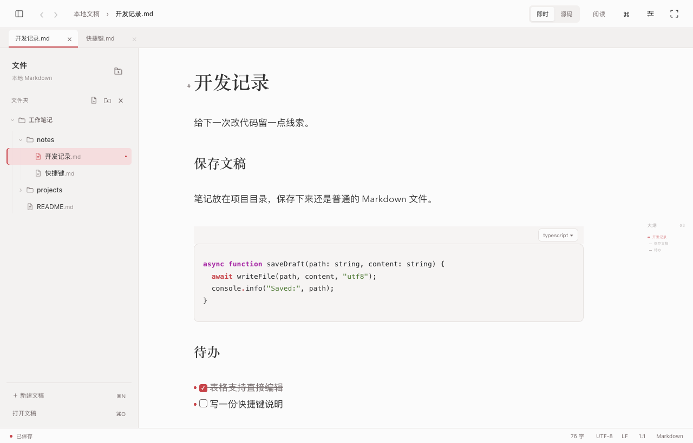
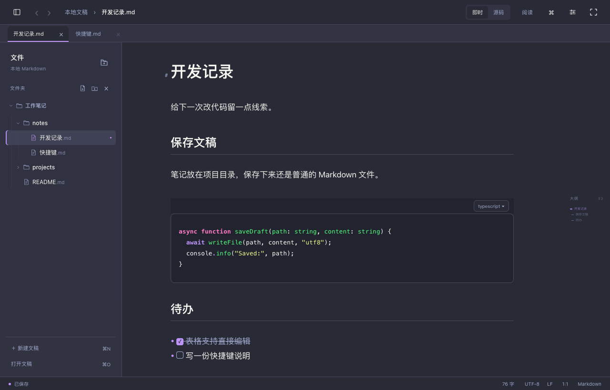

<p align="center">
  
</p>

<h1 align="center">Mokune MD</h1>

<p align="center">macOS 上的本地 Markdown 编辑器</p>

<p align="center">
  <a href="#开始使用">开始使用</a> ·
  <a href="docs/EDITING.md">编辑操作</a> ·
  <a href="docs/THEMES.md">主题</a> ·
  <a href="LICENSE">MIT</a>
</p>

写笔记、整理技术文档，直接打开本地 `.md` 文件就能开始。写的时候看排版，按 `⌘/` 切回源码。

不用注册账号，文稿留在自己的电脑上。



## 平时会用到的

- **写长文**：多标签、大纲、文件夹树和全文搜索。关掉再打开，也能接着上次的位置写。
- **整理内容**：表格里直接改字，拖动图片边缘调整大小；代码高亮、公式、Mermaid、脚注和 Front Matter 也都支持。
- **管理文稿**：未保存内容恢复、本地版本历史、磁盘冲突比较；文件移动后维护相对链接。
- **交付文档**：按当前主题导出 HTML 或 PDF，带上图片、公式和图表。

内置 16 套主题，也可以导入自己的主题。正文宽度、字号和大纲位置都能调整。

<details>
<summary>深色主题</summary>



</details>

## 开始使用

**0.1.0 未公证预览版**

[下载 DMG](https://github.com/zbuzhi/mokune-md/releases/download/v0.1.0/mokune-md-0.1.0-macos-universal-UNNOTARIZED-PREVIEW.dmg) · [下载 ZIP](https://github.com/zbuzhi/mokune-md/releases/download/v0.1.0/mokune-md-0.1.0-macos-universal-UNNOTARIZED-PREVIEW.zip) · [校验文件](https://github.com/zbuzhi/mokune-md/releases/download/v0.1.0/SHA256SUMS.txt)

同一份安装包支持 Apple Silicon 和 Intel。本版尚未经过 Apple 公证，首次打开可能被 macOS 拦截。

想从源码编译的话：

本地构建需要 macOS 13.3+、Xcode、Node.js 24 和 pnpm 11.25.0。

```sh
git clone https://github.com/zbuzhi/mokune-md.git
cd mokune-md
pnpm install --frozen-lockfile
pnpm build
open "dist/Mokune MD.app"
```

只装了 Command Line Tools 的话，可以用 `MOKUNE_ICON_STYLE=legacy pnpm build` 构建静态图标版。更多构建选项见 [构建指南](docs/BUILDING.md)。本地构建使用临时签名，尚未经过 Apple 公证。

应用已接入在线更新。第一次手动安装后，后续可以从应用菜单检查更新；自动检查默认关闭。

## 几个常用操作

| 操作 | 快捷键 |
| --- | --- |
| 保存文稿 | `⌘S` |
| 切换源码与即时预览 | `⌘/` |
| 快速打开文稿 | `⌘P` |
| 打开命令面板 | `⌘⇧P` |
| 查看快捷键提示 | 按住 `⌘` 半秒，松开收起 |

完整列表见 [快捷键说明](docs/SHORTCUTS.md)。

## 文档与反馈

[编辑操作](docs/EDITING.md) · [Markdown 支持范围](docs/MARKDOWN-COVERAGE.md) · [图片与附件](docs/RESOURCES.md) · [导出](docs/EXPORT.md)

遇到问题，欢迎提 [Issue](https://github.com/zbuzhi/mokune-md/issues)，带上系统版本和复现步骤就好。想改代码可以看 [贡献指南](CONTRIBUTING.md)；安全漏洞请走 [私密报告](SECURITY.md)。

## 许可

项目代码采用 [MIT](LICENSE)。依赖、主题和字体保留各自许可证，详见 [第三方声明](THIRD_PARTY_NOTICES.md)。
