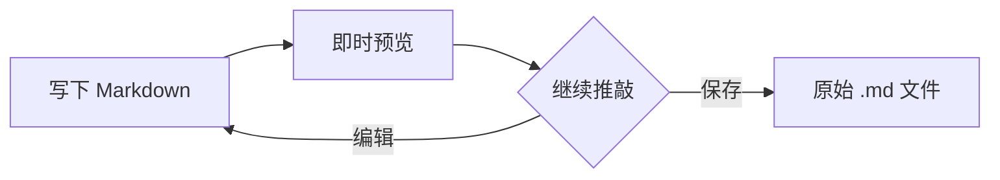
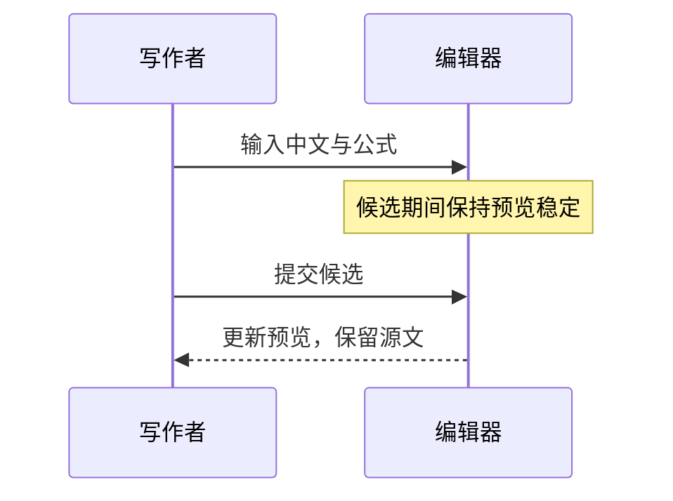

# 让推导与思路，一起清晰

用公式表达关系，用图表梳理过程。文字、数学与代码，仍保存在同一份 Markdown 中。

## 数学，写在句子之间

质量与能量的关系是 $E = mc^2$，求根公式可以写成 $x = \frac{-b \pm \sqrt{b^2-4ac}}{2a}$。

$$
\begin{aligned}
\mathcal{L}(\theta) &= \frac{1}{n}\sum_{i=1}^{n}(y_i - f_\theta(x_i))^2 \\
\theta_{t+1} &= \theta_t - \eta\,\nabla_\theta\mathcal{L}(\theta_t)
\end{aligned}
$$

## 把流程，画出来

## 一次交互的顺序

点击预览可回到源码。按 ⌘⇧M 查看原始标记，再切回即时模式，内容不会被重写。
